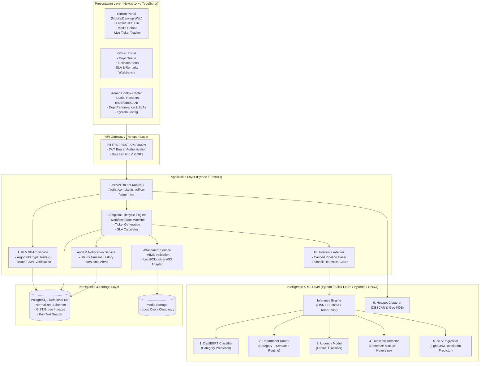
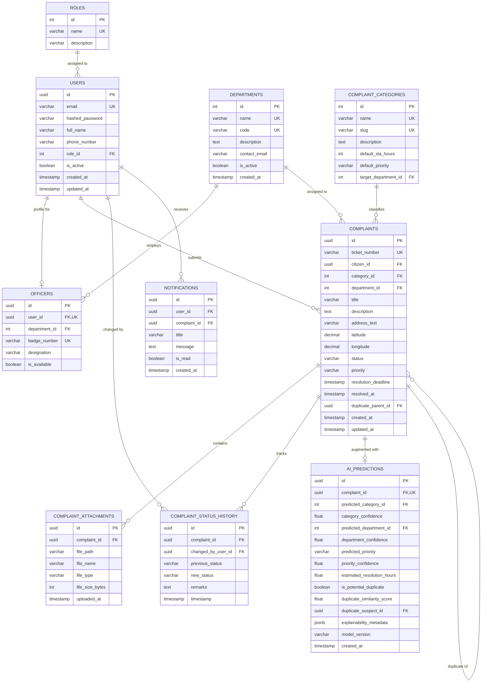
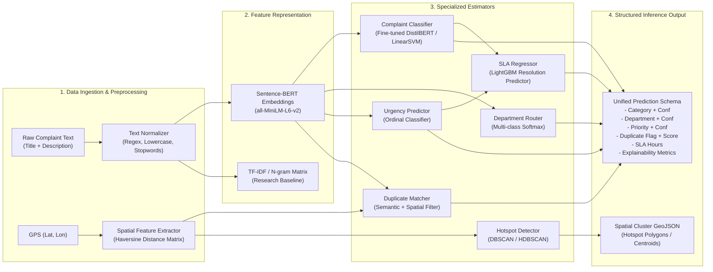
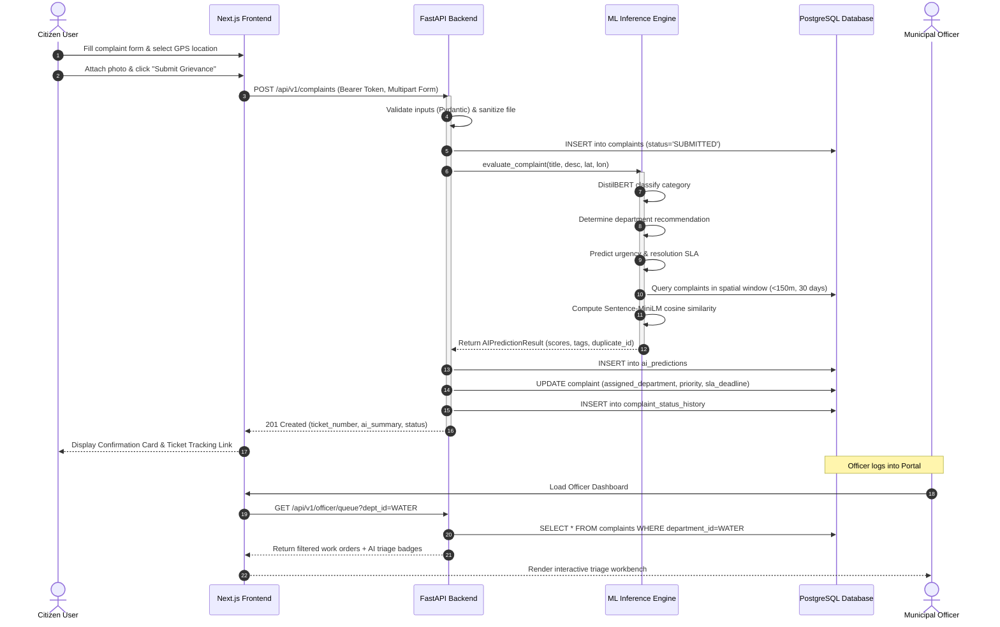
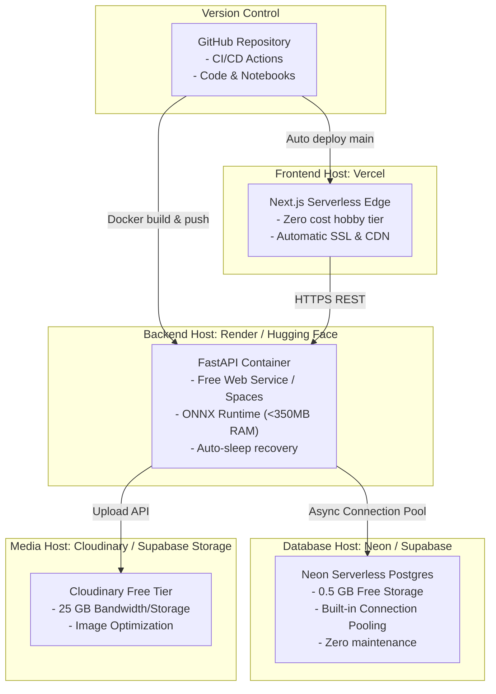

# CityMind AI — System Architecture Specification
**Document Version:** 1.0.0  
**Project:** CityMind AI (AI-Powered Urban Management and Decision-Support Platform)  
**Author:** Lead Software Architect & Senior Full-Stack Engineer  
**Status:** Approved Architecture Blueprint  

---

## 1. Executive Summary & Architectural Vision

CityMind AI is an enterprise-grade, research-oriented urban management and municipal decision-support system. It bridges the gap between civic grievance redressal and intelligent public administration by transforming unstructured citizen reports into structured, triaged, prioritized, and geographically clustered municipal work orders.

### 1.1 Architectural Tenets
1. **Strict Modular Decoupling**: Separation of concerns across `frontend/`, `backend/`, and `ml/`. The backend business logic does not depend directly on heavyweight ML libraries during core runtime execution; instead, it interfaces through a dedicated `InferenceEngine` interface.
2. **Reproducible & Explainable AI**: Every prediction (classification, department routing, urgency scoring, duplicate detection, SLA estimation) yields explainable confidence scores, feature attributions, and audit trails.
3. **Zero-Lock-in & Free-Tier Optimization**: Designed to operate without expensive enterprise cloud infrastructure, utilizing optimized lightweight model runtimes (e.g., ONNX Runtime) capable of executing within 512MB RAM cloud tiers (Render, Neon, Vercel).
4. **Data Integrity & Normalization**: A strictly typed, normalized PostgreSQL schema ensuring ACID compliance, relational integrity, geospatial querying, and historical audit logging.

---

## 2. High-Level System Architecture

The following diagram illustrates the complete architectural blueprint and the interactions across user roles, presentation layers, application services, database engines, and ML pipelines.



---

## 3. Frontend Architecture (Next.js 14+)

### 3.1 Framework & Core Dependencies
- **Core Framework**: Next.js 14+ (App Router architecture with Server Components and selective `'use client'` hydration).
- **Language**: TypeScript (strict type checking enabled).
- **Styling**: Tailwind CSS + `shadcn/ui` (accessible Radix UI primitives with cohesive municipal civic design tokens: navy, slate, emerald, amber, crimson).
- **Form Management & Validation**: `react-hook-form` integrated with `@hookform/resolvers/zod` for zero-runtime schema mismatch.
- **Geospatial Mapping**: `Leaflet` + `react-leaflet` with OpenStreetMap raster tiles, dynamic SSR-safe lazy loading (`next/dynamic`), interactive reverse geocoding, and custom SVG map markers.
- **Data Visualizations**: `recharts` for responsive time-series charts, bar breakdowns, SLA compliance donuts, and department efficiency metrics.
- **State & Server Synchronization**: `@tanstack/react-query` for API query caching, mutation lifecycle, optimistic updates, and background revalidation.
- **Icons**: `lucide-react` for clean, consistent interface iconography.

### 3.2 Frontend Route Directory Architecture
```
frontend/
├── public/
│   ├── icons/
│   ├── images/
│   └── markers/
├── src/
│   ├── app/
│   │   ├── (auth)/
│   │   │   ├── login/page.tsx
│   │   │   └── register/page.tsx
│   │   ├── (citizen)/
│   │   │   ├── layout.tsx
│   │   │   ├── page.tsx                       # Citizen Home / Overview
│   │   │   ├── complaints/
│   │   │   │   ├── new/page.tsx               # Multi-step complaint submission form
│   │   │   │   ├── [id]/page.tsx              # Complaint detail & timeline tracker
│   │   │   │   └── page.tsx                   # My complaints list
│   │   ├── (officer)/
│   │   │   ├── layout.tsx
│   │   │   ├── officer/
│   │   │   │   ├── dashboard/page.tsx         # Department queue & triage board
│   │   │   │   ├── complaints/[id]/page.tsx   # Detailed review, duplicate diff, remarks
│   │   │   │   └── performance/page.tsx       # Officer / Department metrics
│   │   ├── (admin)/
│   │   │   ├── layout.tsx
│   │   │   ├── admin/
│   │   │   │   ├── dashboard/page.tsx         # Executive command center
│   │   │   │   ├── hotspots/page.tsx          # Geospatial hotspot & density map
│   │   │   │   ├── departments/page.tsx       # Department management & SLA thresholds
│   │   │   │   ├── users/page.tsx             # Role assignments & officer management
│   │   │   │   └── analytics/page.tsx         # Deep analytics & research report exports
│   │   ├── layout.tsx
│   │   ├── globals.css
│   │   └── not-found.tsx
│   ├── components/
│   │   ├── ui/                                # shadcn primitives (button, dialog, card, badge...)
│   │   ├── forms/                             # ComplaintForm, LocationPicker, ImageUpload
│   │   ├── maps/                              # ComplaintMap, HotspotMap, ClusterLayer
│   │   ├── charts/                            # ResolutionTrendChart, CategoryDonut, SLAStatusChart
│   │   ├── common/                            # Navbar, Sidebar, StatusBadge, Timeline
│   │   └── layout/                            # Header, Footer, ProtectedRoute
│   ├── hooks/
│   │   ├── use-auth.ts                        # Session context & role guards
│   │   ├── use-geolocation.ts                 # Browser GPS acquisition & reverse geocoding
│   │   └── use-complaints.ts                  # React Query hook abstractions
│   ├── lib/
│   │   ├── api-client.ts                      # Axios/Fetch instance with JWT interceptors
│   │   ├── constants.ts                       # Categories, priorities, status enums
│   │   ├── utils.ts                           # Formatting, classnames helper
│   │   └── validators/                        # Zod validation schemas
│   └── types/                                 # Global TypeScript interfaces
├── package.json
├── tailwind.config.ts
└── tsconfig.json
```

---

## 4. FastAPI Backend Architecture

### 4.1 Framework & Core Design Principles
- **Framework**: FastAPI (Python 3.11+) offering native asynchronous endpoints (`async/await`), automatic OpenAPI 3.0 documentation, and high throughput.
- **ORM & Database Toolkit**: SQLAlchemy 2.0 (Modern asynchronous ORM using `AsyncSession`, `select()` syntax) paired with `asyncpg` driver for non-blocking PostgreSQL I/O.
- **Schema Validation & Settings**: Pydantic v2 with `pydantic-settings` for type-safe environment configuration and millisecond-level serialization.
- **Database Migrations**: Alembic for version-controlled, reproducible database schema migrations.
- **Authentication & Security**: OAuth2 Password Bearer flow, JWT (JSON Web Tokens) with HMAC-SHA256, and password hashing with `argon2-cffi` / `bcrypt`.
- **Modularity**: Domain-Driven package layout separating API controllers (`endpoints`), Domain Services (`services`), Data Access (`models`), and Schemas (`schemas`).

### 4.2 Backend Directory Architecture
```
backend/
├── app/
│   ├── api/
│   │   └── v1/
│   │       ├── endpoints/
│   │       │   ├── auth.py                    # Register, Login, Refresh, Me
│   │       │   ├── users.py                   # Profile, User management (Admin)
│   │       │   ├── complaints.py              # Submit, Query, Details, Status Transitions
│   │       │   ├── departments.py             # Department CRUD & config
│   │       │   ├── officers.py                # Officer assignments & department queues
│   │       │   ├── analytics.py               # Hotspots, KPI stats, SLA metrics
│   │       │   └── ml_service.py              # Health check, model metadata, ad-hoc test
│   │       └── router.py                      # Aggregated v1 API router
│   ├── core/
│   │   ├── config.py                          # BaseSettings (DB URL, JWT Secret, App settings)
│   │   ├── security.py                        # JWT encode/decode, Password hashing
│   │   ├── dependencies.py                    # get_db, get_current_user, RoleChecker
│   │   ├── exceptions.py                      # Custom HTTP exceptions and handlers
│   │   └── logging.py                         # Structured JSON logging
│   ├── db/
│   │   ├── base.py                            # Declarative base & metadata
│   │   ├── session.py                         # Async engine & sessionmaker factory
│   │   └── seed.py                            # Reproducible mock & sample data seeder
│   ├── models/                                # SQLAlchemy 2.0 ORM Declarations
│   │   ├── user.py
│   │   ├── role.py
│   │   ├── department.py
│   │   ├── officer.py
│   │   ├── complaint.py
│   │   ├── complaint_history.py
│   │   ├── attachment.py
│   │   └── ai_prediction.py
│   ├── schemas/                               # Pydantic v2 request/response schemas
│   │   ├── auth.py
│   │   ├── user.py
│   │   ├── department.py
│   │   ├── complaint.py
│   │   ├── analytics.py
│   │   └── ai_prediction.py
│   ├── services/                              # Encapsulated Business Logic
│   │   ├── auth_service.py
│   │   ├── complaint_service.py
│   │   ├── notification_service.py
│   │   ├── storage_service.py
│   │   └── analytics_service.py
│   ├── ml_engine/                             # Backend Inference Gateway
│   │   ├── client.py                          # Singleton ML Inference Coordinator
│   │   ├── preprocessor.py                    # Text cleaning, normalization
│   │   └── adapters/                          # Fallback heuristic vs ONNX model loader
│   └── main.py                                # Application entry point, CORS, Lifespan
├── alembic/
│   ├── versions/
│   └── env.py
├── tests/
│   ├── conftest.py
│   ├── test_auth.py
│   ├── test_complaints.py
│   └── test_ml_inference.py
├── alembic.ini
├── Dockerfile
├── requirements.txt
└── pyproject.toml
```

---

## 5. Normalized PostgreSQL Database Schema

### 5.1 Entity-Relationship Diagram (ERD)



### 5.2 Key Schema Specifications & Integrity Constraints
1. **Primary Keys**: UUIDv4 for transactional and user-facing records (`complaints`, `users`, `attachments`, `ai_predictions`) to prevent sequential enumeration attacks. Standard sequential integers for small static lookup dimensions (`roles`, `departments`, `complaint_categories`).
2. **Indexing Strategy**:
   - `idx_complaints_geo`: Compound B-Tree on `(latitude, longitude)` or PostGIS spatial index.
   - `idx_complaints_ticket`: Unique B-Tree index on `ticket_number`.
   - `idx_complaints_status_dept`: Compound B-Tree on `(department_id, status)` for fast officer queue retrieval.
   - `idx_complaints_citizen`: B-Tree on `citizen_id` for citizen portal lookups.
   - `idx_complaints_fts`: GIN Full-Text Search index on `to_tsvector('english', title || ' ' || description)`.
   - `idx_ai_predictions_complaint`: Unique index on `complaint_id`.
3. **Data Integrity**: Foreign key constraints with `ON DELETE RESTRICT` for audit-critical tables to prevent accidental cascading destruction of historical civic records.

---

## 6. Machine Learning Architecture & Methodologies

The ML layer is designed around rigorous academic research criteria: modularity, explainability, reproducibility, and quantitative evaluation.



### 6.1 Detail of the 7 AI/ML Components

| # | Task | Proposed Approach | Baseline Comparison (Research) | Evaluation Metrics |
|---|---|---|---|---|
| **1** | **Complaint Classification** (12 categories) | Fine-tuned `distilbert-base-uncased` (or lightweight FastText / LinearSVC for low compute) | TF-IDF + MultinomialNB, TF-IDF + Random Forest | Accuracy, Precision, Recall, Macro-F1, Confusion Matrix |
| **2** | **Department Recommendation** | Hybrid Hierarchical Router: Text Embedding + Category prior mapped to Municipal Jurisdiction rules | Naive keyword rule lookup | Top-1 Accuracy, Top-3 Recall, Categorical Cross-Entropy |
| **3** | **Priority / Urgency Prediction** | Ordinal Logistic Regression or DistilBERT Ordinal Head (Critical, High, Medium, Low) | Heuristic Rule Engine (keywords like 'danger', 'sparking', 'leak') | Quadratic Weighted Kappa (QWK), Macro-F1, Precision |
| **4** | **Duplicate Complaint Detection** | Dual-Gate Matcher: Cosine similarity of `all-MiniLM-L6-v2` embeddings $\ge \tau_{text}$ (e.g. 0.82) **AND** Haversine distance $\le d_{max}$ (e.g. 150m) within $t_{window}$ (30 days) | Jaccard lexical similarity + Euclidean distance | Precision@K, Recall@K, ROC-AUC, Mean Reciprocal Rank (MRR) |
| **5** | **Expected Resolution Time** | Gradient Boosted Trees (`LightGBM` / `XGBoost`) utilizing category, priority, department queue load, day of week, text length | Mean historical duration per category | MAE (Mean Absolute Error), RMSE, $R^2$, Median Absolute Error |
| **6** | **Hotspot Analysis** | Density-Based Spatial Clustering of Applications with Noise (`DBSCAN` with Haversine metric, `eps=300m`, `min_samples=5`) + 2D Gaussian Kernel Density Estimation (KDE) | Grid-based cell counting | Silhouette Score, Davies-Bouldin Index, Cluster Density Ratio |
| **7** | **Dashboard Analytics** | Aggregated temporal rollups, moving averages, and cumulative resolution curves | N/A (Descriptive analytics) | Query execution latency (<100ms), Data freshness |

### 6.2 ML Directory Structure
```
ml/
├── data/
│   ├── raw/                           # Raw initial civic datasets
│   ├── processed/                     # Normalized, tokenized splits (train/val/test)
│   └── synthetic/                     # Realistic synthetic seed generator for early dev
├── notebooks/                         # Research & EDA Exploratory Notebooks
│   ├── 01_eda_and_data_cleaning.ipynb
│   ├── 02_classification_benchmarks.ipynb
│   ├── 03_duplicate_detection_eval.ipynb
│   ├── 04_sla_regression_experiments.ipynb
│   └── 05_spatial_hotspot_dbscan.ipynb
├── pipelines/                         # Automated, reproducible pipelines
│   ├── train_classifier.py
│   ├── train_sla_regressor.py
│   ├── evaluate_all.py
│   └── export_onnx.py                 # Quantization & ONNX export for free deployment
├── models/                            # Serialized model weights & metadata
│   ├── registry.json                  # Model version tracking & checksums
│   ├── classifier.onnx
│   ├── sla_regressor.joblib
│   └── category_mapping.json
├── src/                               # Reusable ML library
│   ├── preprocessing.py
│   ├── similarity.py
│   ├── spatial_clustering.py
│   └── metrics.py
├── requirements-ml.txt
└── README.md
```

### 6.3 Explainability & Academic Research Rigor
1. **Explainable AI (XAI)**:
   - For classification: Token importance highlights via Integrated Gradients or Attention Map pooling.
   - For SLA regression: SHAP (SHapley Additive exPlanations) summary values indicating how priority, department backlog, and category shifted predicted hours.
2. **Confidence Thresholding & Fallback System**:
   - If classifier confidence $< 0.55$, flag ticket as `NEEDS_TRIAGE` and suggest Top-3 alternatives for human officer confirmation.
   - Transparent auditing: The system preserves `ai_predictions` in the database, enabling retroactive evaluation of human acceptance vs. AI suggestion.

---

## 7. REST API Specification

All endpoints are prefixed with `/api/v1` and return standardized JSON envelopes.

### 7.1 Response Envelope Structure
```json
{
  "success": true,
  "data": { ... },
  "message": "Operation completed successfully",
  "errors": null,
  "timestamp": "2026-10-04T12:00:00Z"
}
```

### 7.2 API Endpoint Matrix

| Module | Method | Endpoint | RBAC Role | Description |
|---|---|---|---|---|
| **Auth** | `POST` | `/auth/register` | Public | Register citizen account |
| **Auth** | `POST` | `/auth/login` | Public | Authenticate and obtain JWT access token |
| **Auth** | `POST` | `/auth/refresh` | Public | Refresh expired access token |
| **Auth** | `GET` | `/auth/me` | Authenticated | Fetch current user profile & role |
| **Complaints** | `POST` | `/complaints` | Citizen, Admin | Submit new complaint (triggers AI pipeline) |
| **Complaints** | `GET` | `/complaints` | Authenticated | List complaints (auto-scoped by role) |
| **Complaints** | `GET` | `/complaints/{id}` | Authenticated | Detailed complaint view with AI insights |
| **Complaints** | `POST` | `/complaints/{id}/attachments`| Citizen, Admin | Upload photographic evidence |
| **Complaints** | `GET` | `/complaints/{id}/timeline` | Authenticated | Fetch complete lifecycle audit log |
| **Officer** | `GET` | `/officer/queue` | Officer, Admin | Fetch department work queue with filters |
| **Officer** | `PATCH`| `/officer/complaints/{id}/status` | Officer, Admin | Update status (Acknowledged, In Progress, Resolved, Rejected) |
| **Officer** | `POST` | `/officer/complaints/{id}/remarks` | Officer, Admin | Add official officer action remark |
| **Officer** | `GET` | `/officer/complaints/{id}/duplicates`| Officer, Admin | Fetch suspected duplicate pairs & diff |
| **Admin** | `GET` | `/admin/departments` | Admin | List all municipal departments & performance |
| **Admin** | `POST` | `/admin/departments` | Admin | Create/configure municipal department |
| **Admin** | `GET` | `/admin/officers` | Admin | List officers and assignment workloads |
| **Admin** | `POST` | `/admin/officers` | Admin | Register officer and bind to department |
| **Admin** | `GET` | `/admin/analytics/overview` | Admin | High-level KPI counts, SLA breach rates |
| **Admin** | `GET` | `/admin/analytics/hotspots` | Admin | GeoJSON clusters & density coordinates |
| **Admin** | `GET` | `/admin/analytics/export` | Admin | Export research-ready anonymized CSV/JSON |
| **ML Engine**| `POST` | `/ml/predict` | Internal/Admin | Dry-run AI triage prediction on test text |
| **ML Engine**| `GET` | `/ml/health` | Internal/Admin | Model registry status, versions, load times |

---

## 8. Role-Based Access Control (RBAC) & Security Architecture

### 8.1 Role Matrix & Permissions

| Permission / Action | Citizen | Officer | Admin |
|---|:---:|:---:|:---:|
| Submit Complaint | ✅ | ❌ | ✅ |
| View Own Complaints | ✅ | ❌ | ✅ |
| View Department Complaints | ❌ | ✅ (Assigned Dept) | ✅ (All Depts) |
| Change Complaint Status | ❌ | ✅ (Assigned Dept) | ✅ |
| Add Official Remarks | ❌ | ✅ | ✅ |
| Mark Complaint Duplicate / Merge | ❌ | ✅ | ✅ |
| View AI Confidence & Explanations | Basic Summary | ✅ Complete | ✅ Complete |
| View Spatial Hotspot Map | ❌ | Restricted | ✅ Complete |
| Manage Departments & Officers | ❌ | ❌ | ✅ |
| Export Research Dataset | ❌ | ❌ | ✅ |

### 8.2 Security & Data Protection Controls
1. **Stateless JWT Flow**: Signed with `HS256` or `RS256`, 15-minute access token lifespan, 7-day refresh token lifespan stored in HttpOnly, SameSite cookies.
2. **Password Security**: Argon2id with recommended OWASP memory cost parameters (memory 64MB, 3 iterations) or Bcrypt (work factor 12). Plain-text passwords never touch logs.
3. **File Upload Hardening**:
   - Magic bytes validation (verifying true file signature rather than file extension).
   - Strict size limitation (max 5MB per image).
   - Filename sanitization to prevent path traversal (`os.path.basename` with UUID replacement).
4. **Input Sanitization & SQL Injection Defense**:
   - SQLAlchemy parameterized queries completely eliminate SQL injection risk.
   - Pydantic v2 schemas reject unexpected fields and enforce string boundary constraints.
   - HTML sanitization on free-text complaint descriptions to prevent Stored XSS.
5. **CORS & Environment Variables**:
   - Strict CORS origin whitelisting (`ALLOWED_ORIGINS`).
   - All credentials, DB URLs, and secrets loaded via environment variables (`.env`).

---

## 9. End-to-End Inter-Component Communication



---

## 10. Free-Tier Deployment Strategy

The architecture is deliberately engineered to run reliably on zero-cost, free-tier developer platforms without sacrificing performance.



### 10.1 Free-Tier Resource Management Tactics
1. **Memory Budgeting for ML**: Full PyTorch + Transformers consume 1.2GB–2GB RAM, which exceeds Render's 512MB free tier limit.  
   *Mitigation*: We convert trained models into **quantized ONNX format** (`INT8` or `FP16`) and evaluate with `onnxruntime`, dropping memory footprint to **under 200MB RAM**, allowing backend and ML inference to execute seamlessly on the same 512MB container!
2. **Cold Start Resiliency**: Free-tier backends sleep after inactivity.  
   *Mitigation*: Next.js API client includes graceful loading state banners (*"Waking up CityMind municipal engine..."*) with exponential retry logic.
3. **Database Connection Pooling**: Free-tier serverless PostgreSQL instances have strict connection limits (e.g., 20 connections).  
   *Mitigation*: SQLAlchemy configured with `pool_size=5`, `max_overflow=10`, and utilizing Neon's PgBouncer transaction pooling URL.

---

## 11. Technical Risks & Mitigation Plan

| Risk | Impact | Architectural Mitigation |
|---|---|---|
| **High Model Latency on CPU** | Citizen submission form hangs | Asynchronous background processing: ticket is saved immediately; AI predictions are computed via sub-second ONNX inference pipeline. |
| **Model Drift / Misclassification** | Complaints assigned to wrong department | Hybrid Safeguard: Department router assigns complaint to predicted department, but flags complaints with $<60\%$ confidence for manual officer triage with suggested alternatives. |
| **Duplicate False Positives** | Legitimate new grievance suppressed | Dual-Threshold Soft Alert: The system never drops a duplicate; it tags it with `is_potential_duplicate = true` and presents a visual comparison in the Officer Portal for human verification. |
| **Cold Database Cold Starts** | Latency spike on first request | Keep-alive cron ping or health check probe scheduled via GitHub Actions or free monitoring bot (e.g. UptimeRobot). |
| **Unavailability of Real Citizen Data** | Inability to train realistic models early | Deterministic synthetic dataset generator built on municipal taxonomy (NYC 311 / Indian Municipal Corp open schemas) providing 5,000+ realistic labeled tickets. |

---

## 12. Verification & Validation Framework

1. **Backend Integration Tests**: `pytest` with `pytest-asyncio` covering Auth, RBAC guards, Complaint lifecycle transitions, and ML endpoint responses against an in-memory SQLite/Postgres test fixture.
2. **Frontend End-to-End Tests**: Component unit testing via Vitest + React Testing Library; form validation and submission verification.
3. **ML Scientific Validation**: Benchmark scripts printing precision-recall matrices, confusion matrix plots, and baseline comparison tables saved under `ml/reports/`.
