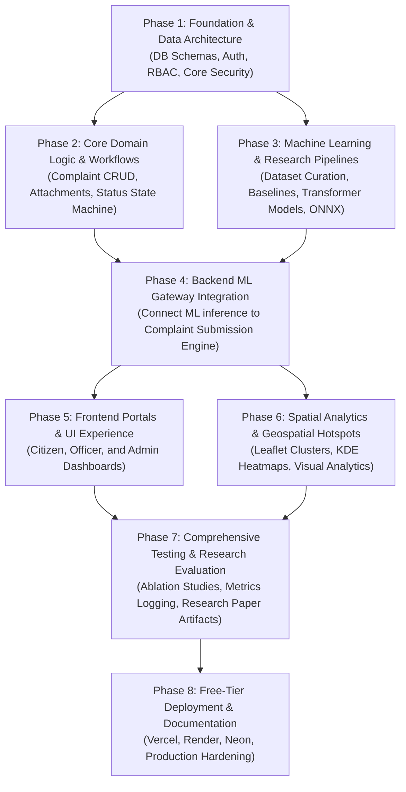

# CityMind AI — Master Development Plan & Implementation Roadmap
**Document Version:** 1.0.0  
**Project:** CityMind AI (AI-Powered Urban Management and Decision-Support Platform)  
**Author:** Lead Software Architect & Senior Full-Stack Engineer  
**Status:** Ready for Phased Execution  

---

## 1. Executive Implementation Strategy

The development of **CityMind AI** follows a disciplined, research-grounded engineering lifecycle. Rather than adopting a monolithic or unstructured build process, the system is partitioned into eight distinct, sequential phases. Each phase establishes a verified, testable baseline upon which subsequent layers are constructed.

### 1.1 Implementation Sequence Rationale: What Comes First and Why

1. **Why Database & Auth First (Phase 1)**: All complaint submissions, assignments, and audit logs are strictly governed by user identities and departmental affiliations. Establishing the database schema, relational constraints, and JWT security layer first ensures data integrity and prevents costly retrofitting later.
2. **Why Core Complaint Engine Next (Phase 2)**: The core civic workflow (creation, geo-tagging, file attachments, status state machine, officer remarks) is the foundational business domain. Without this, the ML models would have no transactional context to interact with.
3. **Why ML Pipelines Before Frontend (Phases 3 & 4)**: As a research project, the ML models must be trained, benchmarked against classical baselines, evaluated with academic metrics, and exported to lightweight ONNX runtimes *before* wiring into the backend. This guarantees that the application never relies on fake, hardcoded, or mock AI logic.
4. **Why Frontend After Backend & ML Integration (Phase 5)**: Developing the frontend against real, working REST APIs with typed OpenAPI/TypeScript contracts prevents speculative frontend work and guarantees seamless client-server integration.
5. **Why Geospatial Analytics in Phase 6**: Spatial clustering (DBSCAN) and Kernel Density Estimation (KDE) depend on having a populated database of complaints with geo-coordinates to render meaningful heatmaps and administrative insights.
6. **Why Research Evaluation in Phase 7**: Systematically computing Confusion Matrices, ROC curves, F1-scores, and MAE benchmarks across train/val/test splits delivers the empirical tables and figures required for the final-year research paper.

---

## 2. Chronological Development Phases

---

### Phase 1: Environment Setup, Database Architecture & Core Authentication
**Goal**: Establish the repository structure, PostgreSQL database with Alembic migrations, and secure JWT-based Role-Based Access Control (RBAC).

#### Key Deliverables:
1. **Repository Structure Initialization**:
   - Establish clean top-level directories: `frontend/`, `backend/`, `ml/`, `docs/`.
   - Setup `.gitignore`, `.env.example`, and configuration management.
2. **Database Engine & Schemas**:
   - Configure SQLAlchemy 2.0 asynchronous engine with `asyncpg`.
   - Implement declarative models: `User`, `Role`, `Department`, `Officer`, `ComplaintCategory`.
   - Initialize Alembic migration environment and generate base migration.
   - Implement database seeding script (`backend/app/db/seed.py`) with initial roles (`CITIZEN`, `OFFICER`, `ADMIN`), initial municipal departments (Roads, Water, Waste, Electricity, Traffic, Health), and standard categories.
3. **Authentication & Authorization**:
   - Argon2id password hashing and verification.
   - JWT access token & refresh token generation with HMAC-SHA256.
   - FastAPI dependency injectors: `get_current_user`, `get_current_active_user`, `RoleChecker(["ADMIN", "OFFICER"])`.
   - Endpoints: `POST /api/v1/auth/register`, `POST /api/v1/auth/login`, `GET /api/v1/auth/me`.

#### Verification Checklist:
- [ ] Database migrations execute cleanly via `alembic upgrade head`.
- [ ] Automated tests confirm password hashing is non-reversible.
- [ ] Access to restricted endpoints without a valid JWT returns `401 Unauthorized`.
- [ ] Access by a user with role `CITIZEN` to an `ADMIN` endpoint returns `403 Forbidden`.

---

### Phase 2: Core Domain Logic & Complaint Lifecycle Engine
**Goal**: Build the complete grievance lifecycle backend, including complaint submission, validation, status transitions, timeline tracking, and media uploads.

#### Key Deliverables:
1. **Complaint Data Models & Schemas**:
   - Implement models: `Complaint`, `ComplaintStatusHistory`, `ComplaintAttachment`.
   - Define Pydantic v2 schemas with coordinate boundary validations:
     - Latitude: $[-90.0, 90.0]$
     - Longitude: $[-180.0, 180.0]$
     - Title length: $[5, 150]$ characters
     - Description length: $[10, 5000]$ characters
2. **Complaint Lifecycle State Machine**:
   - Enforce canonical status transitions:
     - `SUBMITTED` $\rightarrow$ `ASSIGNED`
     - `SUBMITTED` $\rightarrow$ `REJECTED`
     - `ASSIGNED` $\rightarrow$ `IN_PROGRESS`
     - `ASSIGNED` $\rightarrow$ `REJECTED`
     - `IN_PROGRESS` $\rightarrow$ `RESOLVED`
     - `RESOLVED` $\rightarrow$ `CLOSED`
   - Automatically log every transition into `complaint_status_history` with timestamp, actor ID, and remarks.
3. **Secure Attachment Storage Service**:
   - Support multipart image uploads (JPEG, PNG, WebP) with magic-byte MIME type validation.
   - File size caps (max 5MB) and unique filename generation via UUIDv4.
   - Local disk storage adapter with interface readiness for Cloudinary/S3.
4. **Ticket Generation Service**:
   - Generate unique human-readable ticket identifiers: `CM-YYYYMMDD-XXXX` (e.g. `CM-20261004-8921`).
5. **Endpoints**:
   - `POST /api/v1/complaints`
   - `GET /api/v1/complaints` (filterable by category, status, priority, date range, citizen ID)
   - `GET /api/v1/complaints/{id}`
   - `POST /api/v1/complaints/{id}/attachments`
   - `GET /api/v1/complaints/{id}/timeline`

#### Verification Checklist:
- [ ] Submitting a complaint returns a unique ticket number and persists coordinates.
- [ ] Non-image files or files exceeding 5MB are rejected with `422 Unprocessable Entity`.
- [ ] Status updates generate an immutable record in `complaint_status_history`.
- [ ] Citizens cannot access or update complaints filed by other citizens.

---

### Phase 3: Machine Learning & Research Pipelines
**Goal**: Develop reproducible ML pipelines for the 7 intelligent features, benchmark models against classical baselines, evaluate metrics, and export lightweight deployment artifacts.

#### Key Deliverables:
1. **Dataset Curation & Generation Tooling**:
   - Build `ml/data/synthetic/generate_civic_data.py`: Creates a balanced, realistic corpus of 3,000–5,000 municipal complaints across the 12 target categories with realistic geographic coordinate clusters (simulating city wards).
   - Partition dataset into strict 70% Train, 15% Validation, and 15% Test splits with fixed seed (`random_state=42`) to prevent data leakage.
2. **Model 1: Complaint Category Classifier**:
   - Baseline: TF-IDF + Logistic Regression / LinearSVC.
   - Advanced: Fine-tuned DistilBERT (`distilbert-base-uncased`) or FastText classifier.
   - Evaluation: Accuracy, Precision, Recall, Macro-F1 score, and Confusion Matrix.
3. **Model 2: Department Recommendation Engine**:
   - Hierarchical routing model combining predicted category confidence with jurisdictional semantic rules.
4. **Model 3: Priority / Urgency Estimator**:
   - Ordinal classification model classifying into `CRITICAL`, `HIGH`, `MEDIUM`, `LOW`.
   - Feature integration: Text urgency indicators (danger, life-threatening, flood, sparking, collapse), category base risk, and report time.
5. **Model 4: Duplicate Complaint Detector**:
   - Semantic Sentence Embeddings using `sentence-transformers/all-MiniLM-L6-v2`.
   - Compute pairwise cosine similarity combined with Haversine distance geofencing ($d \le 150\text{ meters}$) and temporal windowing ($t \le 30\text{ days}$).
6. **Model 5: Expected Resolution Time (SLA Regressor)**:
   - LightGBM / XGBoost regressor predicting resolution time in hours.
   - Features: Category one-hot, priority score, department backlog count, day of week, description token length.
   - Evaluation: MAE, RMSE, $R^2$.
7. **Model 6: Hotspot Analysis**:
   - Unsupervised spatial clustering via `scikit-learn` DBSCAN (using `metric='haversine'`).
   - 2D Gaussian Kernel Density Estimation (KDE) generating spatial density contours.
8. **Export & Optimization**:
   - Convert models to ONNX format with dynamic batching.
   - Validate ONNX outputs against original PyTorch/Scikit-learn models (tolerance $< 10^{-4}$).

#### Verification Checklist:
- [ ] ML scripts run end-to-end without manual intervention.
- [ ] Confusion matrix and evaluation reports are generated in `ml/reports/`.
- [ ] ONNX model artifact loads in $< 100\text{ms}$ and consumes $< 150\text{MB}$ memory.
- [ ] Zero hard-coded fake predictions; all outputs stem from model mathematical operations.

---

### Phase 4: Backend ML Gateway Integration
**Goal**: Integrate the trained ML models into the FastAPI complaint intake and officer workflow pipelines.

#### Key Deliverables:
1. **Backend ML Inference Adapter (`backend/app/ml_engine/`)**:
   - Implement `MLInferenceClient` singleton with lazy artifact loading.
   - Add graceful fallback: If ONNX model weights are not found, run deterministic rule-based heuristic classifier with transparent flag `is_fallback=true`.
2. **Automated Triage Pipeline in Complaint Submission**:
   - When a citizen posts a complaint, trigger `evaluate_complaint()`:
     - Predict category and assign confidence.
     - Recommend municipal department.
     - Predict priority urgency.
     - Scan local radius for duplicate tickets; if duplicate similarity $> 0.80$, flag as potential duplicate.
     - Estimate resolution SLA hours and set `resolution_deadline`.
   - Store complete AI prediction payload in `ai_predictions` table.
3. **Officer AI Workbench Endpoints**:
   - `GET /api/v1/officer/complaints/{id}/duplicates`: Returns duplicate candidates with similarity scores and side-by-side text comparisons.
   - `GET /api/v1/ml/health`: Returns model version, inference latency, and memory footprint.

#### Verification Checklist:
- [ ] Submitting a complaint automatically creates a corresponding record in `ai_predictions`.
- [ ] Submitting two identical complaints within 50 meters immediately flags the second as a duplicate candidate with high confidence.
- [ ] End-to-end complaint submission with ML inference finishes in $< 350\text{ms}$ on standard CPU.

---

### Phase 5: Frontend Portals & UI Implementation (Next.js 14+)
**Goal**: Build a modern, accessible, government-grade web application featuring dedicated portals for Citizens, Officers, and Administrators.

#### Key Deliverables:
1. **Design System & Civic Theme**:
   - Setup Tailwind CSS with civic design palette (Deep Navy `#0F172A`, Slate `#334155`, Municipal Blue `#1E40AF`, Alert Amber `#D97706`, Emergency Red `#DC2626`, Success Emerald `#059669`).
   - Reusable `shadcn/ui` components: Forms, Modals, Badges, Tables, Tooltips, Accordions.
2. **Authentication Flow**:
   - Citizen registration and login forms with real-time Zod validation.
   - Secure token storage, session context, and route guard redirects.
3. **Citizen Portal**:
   - Multi-step complaint submission form:
     - Step 1: Issue title and description with live AI category suggestion preview.
     - Step 2: Interactive Leaflet map with browser GPS auto-detect, draggable pin, and reverse geocoding address preview.
     - Step 3: Media upload with thumbnail preview.
     - Step 4: Submission review and immediate ticket receipt.
   - Complaint Tracking Page:
     - Search by ticket number.
     - Visual vertical timeline showing status history, officer remarks, and estimated resolution SLA.
4. **Officer Portal**:
   - Department Work Queue: Tabular list with multi-parameter filtering (Status, Priority, Category, Date).
   - Ticket Detail & Triage Workbench:
     - Full complaint view with uploaded evidence viewer.
     - AI Recommendation Card (Predicted department, priority score, estimated resolution time).
     - Duplicate Warning Banner with side-by-side diff modal and "Merge as Duplicate" action.
     - Status transition action bar with mandatory remark input.
5. **Admin Portal**:
   - Executive Statistics Overview: Total complaints, open vs. resolved ratio, average resolution time, SLA compliance percentage.
   - Department Management: View and configure department details and officer rosters.
   - Officer Management: Register new municipal officers and bind them to departments.

#### Verification Checklist:
- [ ] Citizen can log in, submit a complaint with map pin, and view the ticket in "My Complaints".
- [ ] Officer sees only complaints relevant to their department.
- [ ] Updating a complaint status in the Officer Portal immediately updates the Citizen's timeline view.
- [ ] Responsive UI verified on mobile viewport ($375\text{px}$) and desktop ($1440\text{px}$).

---

### Phase 6: Geospatial Analytics & Advanced Visualization
**Goal**: Implement interactive hotspot analysis, density heatmaps, and analytical dashboards for municipal decision support.

#### Key Deliverables:
1. **Interactive Hotspot Map (Admin)**:
   - Full-screen Leaflet map integrating DBSCAN cluster polygons and complaint marker clusters (`leaflet.markercluster`).
   - Color-coded cluster intensity: Red (Critical density), Orange (Moderate density), Blue (Scattered).
   - Tooltips displaying cluster metrics: Total complaints, dominant category (e.g. "80% Potholes"), and active status.
2. **Municipal Performance Analytics**:
   - Recharts visualizations:
     - Daily complaint intake vs. resolution volume over time (Line chart).
     - Category breakdown distribution (Donut chart).
     - Department resolution efficiency and SLA breach count (Bar chart).
3. **Data Export & Reporting**:
   - Export filtered complaint reports to CSV for municipal committee reviews or research analysis.

#### Verification Checklist:
- [ ] Hotspot map renders clusters smoothly with $> 1,000$ points without UI freezing.
- [ ] Filtering analytics by department or date range dynamically updates all Recharts charts.

---

### Phase 7: Comprehensive Testing, Academic Validation & Documentation
**Goal**: Perform end-to-end integration testing, execute ML scientific benchmarks, generate research paper figures, and finalize system documentation.

#### Key Deliverables:
1. **Automated Test Suite**:
   - Backend: Unit and integration tests (`pytest`) covering Auth, RBAC, Complaints, ML inference, and error handling.
   - Frontend: Unit tests for core forms, hooks, and validators.
2. **Scientific Evaluation Reports for Research Paper**:
   - Benchmark script (`ml/pipelines/evaluate_all.py`):
     - Produces publication-quality Confusion Matrix graphics (`.png`, `.pdf`).
     - Generates Markdown/LaTeX tables comparing Baseline vs. Proposed Transformer models on Accuracy, Precision, Recall, and Macro-F1.
     - Produces Duplicate Detection ROC curve and Precision-Recall curve.
     - Produces SLA Prediction error metrics table (MAE, RMSE, $R^2$).
3. **Documentation Package**:
   - High-quality root `README.md` with complete architecture overview, system prerequisites, local setup instructions, and API docs.
   - `docs/API_REFERENCE.md`: Detailed endpoint schemas and cURL examples.
   - `docs/RESEARCH_METHODOLOGY.md`: Experimental design, dataset provenance, model architectures, and benchmark results.

#### Verification Checklist:
- [ ] Test coverage exceeds 80% on backend core services.
- [ ] ML evaluation scripts reproduce documented figures deterministically from seed.
- [ ] Documentation contains zero broken links and provides step-by-step reproduction instructions.

---

### Phase 8: Free-Tier Deployment & Production Hardening
**Goal**: Deploy the complete CityMind AI platform to reliable free-tier cloud infrastructure and verify end-to-end functionality.

#### Key Deliverables:
1. **Database Setup**:
   - Provision free-tier PostgreSQL instance on **Neon** or **Supabase**.
   - Execute production migrations via `alembic upgrade head`.
   - Seed initial lookup data (roles, departments, categories).
2. **Backend Deployment**:
   - Containerize backend via multi-stage Dockerfile (`backend/Dockerfile`).
   - Deploy web service on **Render.com** (Free Web Service) or **Hugging Face Spaces** (Docker CPU).
   - Configure environment variables (`DATABASE_URL`, `JWT_SECRET`, `ALLOWED_ORIGINS`).
3. **Frontend Deployment**:
   - Deploy Next.js frontend to **Vercel** (Hobby Tier).
   - Bind production environment variable `NEXT_PUBLIC_API_URL`.
4. **CORS & Domain Security**:
   - Validate CORS configuration between Vercel frontend and Render backend.
   - Test cold-start handling and user feedback alerts.

#### Verification Checklist:
- [ ] Live application accessible via public Vercel URL.
- [ ] End-to-end flow verified: Citizen registration $\rightarrow$ Complaint submission $\rightarrow$ AI triage $\rightarrow$ Officer resolution $\rightarrow$ Admin hotspot visualization.
- [ ] All free-tier resource usages stay well within limits.

---

## 3. Milestone Summary & Research Deliverables Matrix

| Milestone | Target Phase | Key Deliverable | Research & Technical Output |
|---|---|---|---|
| **M1: Core System & DB** | Phase 1 & 2 | Database Schema, Auth, Complaint Engine | Working CRUD API, RBAC security, Normalized Schema |
| **M2: ML Benchmarking** | Phase 3 | Dataset, Baseline & Transformer Models | Empirical benchmark tables, Confusion Matrix, ONNX artifacts |
| **M3: Intelligent Backend**| Phase 4 | Integrated AI Triage & Duplicate Detector | Real-time AI classification & duplicate detection API |
| **M4: Civic Web Platform** | Phase 5 | Citizen, Officer & Admin Portals | Full responsive Next.js frontend with Leaflet maps |
| **M5: Spatial Intelligence**| Phase 6 | Geospatial Hotspots & Analytics | DBSCAN cluster visualizations, Density heatmaps, Recharts |
| **M6: Research Validation** | Phase 7 | Test Suites, Research Evaluation Package | LaTeX tables, ROC curves, complete academic documentation |
| **M7: Public Deployment** | Phase 8 | Vercel + Render + Neon Live Deployment | Live public demonstration URL, final project release |
